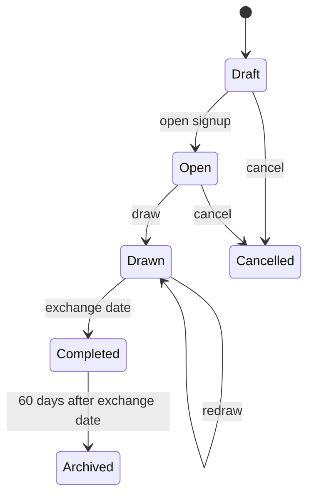

# Santa Swap Spec

## Overview

Santa Swap is a small web app for running a family and friends Secret Santa: an organiser opens a round, invites people, and the app draws pairings in secret and tells each person who they are buying for.

**Goals**

- An organiser can set up a round and invite everyone in a few minutes.
- Every participant learns their giftee privately, by email and in the app.
- The draw respects exclusions and never pairs anyone with themselves.
- Non-technical users can use it on a phone without help.

**Non-goals for v1**

- Public or large-group use (target is under 30 people per round).
- Payments, gift purchasing or shipping.
- Chat between participants.

## Roles and permissions

There are two roles per round. A user can be organiser in one round and participant in another.

| Action | Organiser | Participant |
| --- | --- | --- |
| Create round, edit settings | Yes | No |
| Invite and remove people | Yes, at any time before the round is completed | No |
| Set exclusions | Yes | No |
| Trigger the draw | Yes | No |
| See all assignments | Only if not participating | Never |
| See own giftee and their wishes | Yes, if participating | Yes |
| See other participants' wishes | Only their own giftee's, if participating | Only their own giftee's |
| Edit own profile and wishes | Yes | Yes |
| Cancel or archive the round | Yes | No |

An organiser who also participates is treated as a participant for visibility. This is set by the "Organiser participates" checkbox in round setup and is locked once the draw has run: the app never shows them anyone else's pairing. Co-organisers and ownership transfer are out of scope for v1.

## Round lifecycle

Every round is in exactly one state, and each action in the app is allowed only in specific states.

| State | What happens | Allowed actions |
| --- | --- | --- |
| Draft | Organiser configures the round | Edit settings, add exclusions |
| Open | Invites are out, people join and add wishes | Invite, remove participants, edit settings, draw |
| Drawn | Pairings exist and have been emailed | View result, edit wishes, remove participants, redraw |
| Completed | Exchange date has passed | View only |
| Archived | 60 days after the exchange date | Personal data deleted |
| Cancelled | Organiser stopped the round before the draw | None |

## Functional requirements

### Round setup

The organiser creates a round with these settings, all editable until the draw:

| Setting | Type | Notes |
| --- | --- | --- |
| Name | Text | e.g. "Family Christmas" |
| Budget | Amount + currency | Shown to all participants |
| Signup deadline | Date | Reminders are sent before it |
| Wishes required | Yes / No | If yes, a participant counts as ready only after adding wishes |
| Exchange date and place | Date + text | Optional, shown to all |
| Organiser participates | Checkbox | Checked by default; if checked, the organiser cannot see other pairings |
| Exclusions | Pairs of people | Directional: A must not draw B. Set by the organiser only |

### Invitations

The organiser invites people by email or by a shareable link. An email invite is bound to that address. A link invite can be used by anyone who has it: they join the round directly, without approval. Because of that, the link must be revocable and expire at the signup deadline, and the organiser can remove any participant at any time before the round is completed. The organiser sees each invitee's status: invited, joined, ready, declined.

### Authentication

Users sign in with a magic link sent by email, so no passwords are needed. Accepting an invite with an unknown email creates an account. Accepting with a known email signs the user in and adds them to the round.

### Participation

After joining, a participant confirms participation and adds optional info: display name, gift wishes (free text and links), and notes such as sizes or things to avoid. A participant can decline or leave before the draw.

Wishes and notes are visible only to the participant themselves and to their giver after the draw. Nobody else sees them, including the organiser. The organiser only sees whether each participant has added wishes, so they know who is ready.

### The draw

The draw assigns each participant exactly one giftee so that every participant gives and receives exactly once, nobody draws themselves, and no exclusion is violated. Before drawing, the app checks the minimum of 3 participants and whether a valid assignment exists. If none exists, the organiser sees which exclusions block it and nothing is drawn.

Invitees who have not joined by the draw are left out.

If wishes are required and any joined participant has not added wishes yet, the draw is blocked. The organiser sees who is not ready and can either wait for them or remove them from the round, then draw manually once everyone left is ready.

### Changes after the draw

After the draw, settings are locked. The organiser can still remove a participant, for example if someone drops out. Removing a participant after the draw always triggers a full redraw: every pairing is drawn again from scratch, and every remaining participant gets a new email with their (possibly new) giftee. Participants can still edit their wishes; their giver is notified of the change.

### Viewing the result

A participant sees, when signed in: their giftee's name, wishes and notes, the budget, and exchange date. They never see who drew them.

### Notifications

All notifications are emails with a link into the app.

| Event | Recipient |
| --- | --- |
| Invited to a round | Invitee |
| Signup deadline approaching (e.g. 3 days before) | Invitees not yet ready |
| Draw completed | Each participant, with their giftee |
| Redraw completed | Each remaining participant, with their new giftee |
| Removed from a round | The removed participant |
| Giftee updated their wishes | That giftee's giver |

## UI and visual design

The UI is clean and modern first, festive second: Christmas shows up in colour and a few small touches, never at the cost of clarity. Every screen should be usable by someone who rarely uses websites, on a phone or a large screen.

### Principles

**One task per screen.** Each screen has one clear purpose and one primary button. Secondary actions are visually quieter.

**Plain language.** Labels say what happens ("Add my wishes", "Draw names"), no jargon like "round state" or "token". Every error message says what to do next.

**Always show where you are.** The round page shows the current state and the next step, e.g. "Waiting for 2 people to join. Draw is on 10 December."

**Forgiving.** Destructive actions (remove person, redraw, cancel round) ask for confirmation and explain the consequence. Removing someone after the draw clearly states that everyone will get a new giftee.

### Visual style

| Token | Suggested colour | Use |
| --- | --- | --- |
| Primary | Deep pine green, e.g. #1F5C45 | Primary buttons, links, active states |
| Accent | Cranberry red, e.g. #B3263A | Highlights, the giftee reveal, badges |
| Highlight | Warm gold, e.g. #D4A64A | Small decorative details only, never text |
| Background | Warm off-white, e.g. #FBF8F3 | Page background |
| Surface | White | Cards and forms |
| Text | Near-black, e.g. #1E1E1E | Body text |

Colours are final only after a contrast check: all text and buttons must reach WCAG AA. Red and green must never be the only way to tell states apart, since red-green colour blindness is common. Always pair colour with text or an icon.

Festive touches stay small: a subtle snowflake or star pattern in the header, a gift icon on the result card, and an optional reveal animation when a participant first opens their giftee. Animations respect the system's reduced-motion setting.

Typography uses one clean sans-serif (e.g. Inter or Nunito) at a base size of 18px, larger than usual for readability. A friendlier display font may be used for page titles only.

### Layout and responsiveness

Mobile first with a single column. On large screens content stays centred at a max width of about 720px rather than stretching. Tap targets are at least 44 by 44px. Primary buttons are full width on phones. Navigation is minimal: a logo linking home and an account menu, no sidebar.

### Key screens

| Screen | Who | Main content | Primary action |
| --- | --- | --- | --- |
| Sign in | Everyone | Email field, explanation of the magic link | Send sign-in link |
| My rounds | Everyone | Cards for each round with state and next step | Open a round / Create round |
| Create round | Organiser | Short step-by-step form: basics, budget and dates, participation, exclusions | Create round |
| Invite page | Invitee | Round name, organiser, budget, exchange date | Join round |
| Round page (organiser) | Organiser | People and their status (who is not ready highlighted), settings summary, exclusions | Invite people / Draw names |
| Round page (participant) | Participant | Round info, own wishes, status | Add my wishes |
| My giftee | Participant | Giftee name, wishes, notes, budget, exchange date | None, read-only |

### Emails

Emails follow the same colours and tone, stay short, and have one clear button. The draw email names the giftee directly so people who never open the site still get the essential information.

## Tech stack

| Area | Choice |
| --- | --- |
| Framework | Next.js with TypeScript (UI and API in one app) |
| Database | Postgres on Supabase |
| Auth | Supabase Auth with magic links |
| Data access | Drizzle ORM |
| Email | Resend |
| Hosting | Vercel |
| Scheduled jobs | Supabase pg_cron or Vercel Cron for reminders and data deletion |

The draw algorithm and other domain logic live in their own module with no framework or database imports, so they can be tested in isolation.

## Data model

Six entities cover v1. Field lists are a starting point, not final.

| Entity | Key fields | Notes |
| --- | --- | --- |
| User | id, email, displayName, createdAt | One per email address |
| Round | id, organiserId, name, budget, currency, signupDeadline, wishesRequired, exchangeDate, exchangePlace, organiserParticipates, state | State per lifecycle section |
| Invitation | id, roundId, email (nullable), token, expiresAt, revokedAt, status | Email invites set email, link invites leave it null |
| Participant | id, roundId, userId, status, wishes, notes, joinedAt | status: joined, ready, declined, removed |
| Exclusion | id, roundId, giverId, receiverId | Directional; two rows for a mutual exclusion |
| Assignment | id, roundId, giverId, receiverId, drawVersion | drawVersion increments on each redraw; only the latest counts |

Rounds do not keep history across years; each round stands alone.

Assignments are only readable by the giver themselves, and wishes only by their owner and their giver. This is enforced on the server (Supabase row-level security plus server-side checks), never just hidden in the UI.

## Non-functional requirements

**Usability.** Mobile first, since most people will open the email on a phone. Plain language and large tap targets so older family members can use it unaided.

**Accessibility.** WCAG 2.2 AA: keyboard navigation, visible focus, sufficient contrast, labelled form fields.

**Language.** English UI for v1, with strings kept in one place so a German translation can be added later.

**Privacy.** Store only email, display name, wishes and notes. All personal round data (participants, wishes, notes, exclusions, assignments) is deleted 60 days after the exchange date, when the round moves to Archived. No tracking or analytics beyond basic error logging.

**Security.** Magic links and invite tokens are single-use or time-limited and unguessable. All pairing data is access-checked server-side.

**Reliability.** Emails must be delivered reliably, so use a transactional email provider rather than raw SMTP. A participant who misses the email can always see their result by signing in.

**Cost.** Hosting should fit a free or very low-cost tier. Check the free tier limits of each service before December, including whether inactive Supabase projects get paused.

## Edge cases

These cases must behave as described below; each has a matching acceptance criterion.

| Area | Case | Expected behaviour |
| --- | --- | --- |
| Input | Same email invited twice | Second invite is rejected with a message that the person is already invited |
| Input | User tries to join a round they are already in | They are taken to the round page; no duplicate participant is created |
| Input | Exclusion refers to a person who was removed | The exclusion is deleted together with the participant |
| Input | Signup deadline in the past, or after the exchange date | Form shows a validation error; round cannot be saved |
| Input | Wishes with very long text, emoji, links or HTML | Text is length-limited (e.g. 2,000 characters), emoji are preserved, HTML is escaped, links open in a new tab |
| Timing | Organiser double-clicks "Draw names" or draws from two tabs | The draw runs exactly once; the second request returns the existing result |
| Timing | Settings edited while a draw is in progress | The draw locks the round first; the edit is rejected with a message that the draw has started |
| Timing | Participants in different timezones | All deadlines are stored in UTC and defined in the organiser's timezone; the UI shows that timezone next to each date |
| Email | Invite email bounces | Invitation is marked as undeliverable and the organiser sees a warning to check the address |
| Email | Email security scanner opens a magic link before the user | Opening the link shows a confirm button; the token is only used when the button is pressed |
| Email | Magic link opened on a different device than requested | Sign-in works on the device where the link is opened |
| Accounts | Organiser deletes their account during an open or drawn round | Account deletion is blocked until the organiser cancels or completes their rounds |
| Accounts | Participant is in several rounds at once | Each round's giftee is shown only inside that round, with the round name always visible |
| Draw | Removing a participant leaves fewer than 3 people after the draw | The removal is blocked with a message explaining the minimum, unless the organiser cancels the round |
| Draw | Redraw gives someone the same giftee as before | Allowed; the redraw is fully random |

## Acceptance criteria

Each criterion should map to at least one automated test. The draw rules suit property-based tests over random groups and exclusion sets.

**Draw**

- [ ] **AC-DRAW-01** For any group of 3 or more with a satisfiable exclusion set, every participant gives exactly once and receives exactly once.
- [ ] **AC-DRAW-02** No participant is ever assigned to themselves.
- [ ] **AC-DRAW-03** No assignment violates an exclusion.
- [ ] **AC-DRAW-04** With an unsatisfiable exclusion set, no assignments are stored and the organiser sees which exclusions block the draw.
- [ ] **AC-DRAW-05** With fewer than 3 ready participants, the draw is blocked with a clear message.
- [ ] **AC-DRAW-06** When wishes are required, the draw is blocked while any joined participant has no wishes, and the organiser sees who is not ready.
- [ ] **AC-DRAW-07** After the organiser removes the participants who are not ready, the draw can run.
- [ ] **AC-DRAW-08** A redraw increments drawVersion and only the latest version is ever shown.
- [ ] **AC-DRAW-09** Removing a participant after the draw triggers a full redraw for all remaining participants.

**Privacy**

- [ ] **AC-PRIV-01** A participant's API requests can only return their own assignment; requesting another returns 403 or 404.
- [ ] **AC-PRIV-02** A participating organiser cannot see any assignment but their own, in UI or API.
- [ ] **AC-PRIV-03** Nobody can find out who drew them.
- [ ] **AC-PRIV-04** A participant's wishes and notes are only returned to them and to their giver, never to other participants or the organiser.
- [ ] **AC-PRIV-05** 60 days after the exchange date, all personal data of the round is deleted.

**Invites and access**

- [ ] **AC-INV-01** A valid invite link lets a signed-in user join the round directly, without approval.
- [ ] **AC-INV-02** A revoked or expired invite link cannot be used to join.
- [ ] **AC-INV-03** An email invite can only be accepted by that email address.
- [ ] **AC-INV-04** A magic link works once and expires after a short window.
- [ ] **AC-INV-05** Only the organiser can create, edit or delete exclusions.
- [ ] **AC-INV-06** The organiser can remove any participant until the round is completed; the removed person is notified.

**Lifecycle**

- [ ] **AC-LIFE-01** Settings cannot be changed after the draw.

**Notifications**

- [ ] **AC-NOTIF-01** After a successful draw or redraw, each participant receives exactly one email naming only their own giftee.
- [ ] **AC-NOTIF-02** When a giftee edits wishes after the draw, only their giver is notified.

**Edge cases**

- [ ] **AC-EDGE-01** Inviting an already invited email, or joining a round twice, never creates a duplicate participant.
- [ ] **AC-EDGE-02** Removing a participant also removes every exclusion that references them.
- [ ] **AC-EDGE-03** A round cannot be saved with a signup deadline in the past or after the exchange date.
- [ ] **AC-EDGE-04** HTML in wishes is rendered as text, never executed.
- [ ] **AC-EDGE-05** Concurrent draw requests for one round produce exactly one set of assignments.
- [ ] **AC-EDGE-06** A settings change submitted during a running draw is rejected.
- [ ] **AC-EDGE-07** Deadlines trigger at the same moment regardless of the viewer's timezone.
- [ ] **AC-EDGE-08** A bounced invite is flagged to the organiser.
- [ ] **AC-EDGE-09** Fetching a magic link URL without pressing confirm does not use up the token.
- [ ] **AC-EDGE-10** An organiser with an open or drawn round cannot delete their account.
- [ ] **AC-EDGE-11** A user in two rounds only ever sees the giftee that belongs to the round they are viewing.
- [ ] **AC-EDGE-12** Removing a participant after the draw is blocked if fewer than 3 people would remain.

## Testing guidelines

No feature is done until its tests pass in CI. Tests are written from this spec: every acceptance criterion above maps to at least one named test, and the test name references the criterion it covers.

### Test layers

| Layer | What it covers | Tools | Share of tests |
| --- | --- | --- | --- |
| Unit | Draw algorithm, exclusion validation, state transitions, date and deadline logic | Vitest | Most |
| Property-based | Draw invariants over random groups and exclusion sets | fast-check | A few, run many cases |
| Integration | API routes and database access with a local Supabase instance: permissions, row-level security, invites, auth, notifications queued | Vitest + Supabase CLI | Many |
| Component | Forms, validation messages, empty and error states | Testing Library | Moderate |
| End-to-end | The main user journeys in a real browser, desktop and mobile viewport | Playwright | Few |
| Accessibility | Automated checks on every key screen | axe (via Playwright) | One per screen |

### What must always be tested

**The draw.** Keep the draw a pure function (participants and exclusions in, assignments or an error out) so it is easy to test in isolation. Property tests check for any valid input: everyone gives and receives exactly once, nobody draws themselves, no exclusion is violated. Also test edge cases directly: exactly 3 people, impossible exclusion sets, everyone excluded from one person.

**Privacy and permissions.** For every endpoint or query that returns pairing data or wishes, test that another participant, a participating organiser and a signed-out user are all refused. These tests hit the API and the database policies, not the UI, because hiding data in the UI is not protection.

**State transitions.** For each lifecycle state, test that allowed actions succeed and every other action is refused.

**Invites and sign-in.** Expired, revoked and reused links are rejected. An email invite cannot be accepted by a different address.

**Notifications.** Use a fake email provider in tests and assert who received which email and that each draw email names only that recipient's giftee.

**Scheduled jobs.** Reminders and the 60-day deletion run as jobs that can be triggered directly in tests with a fake clock.

### End-to-end journeys

1. Organiser creates a round, invites 3 people by email, all join and add wishes, organiser draws, each person sees only their own giftee.
2. A person joins through a shared link on a mobile viewport.
3. A draw with impossible exclusions shows a clear error and stores nothing.
4. With wishes required, one person has no wishes; the draw is blocked, the organiser removes them and draws successfully.
5. Someone drops out after the draw, the organiser removes them, everyone remaining gets a new email.

### Rules

- Every bug fix starts with a failing test that reproduces the bug.
- Time is controlled in tests (fake clock) so deadlines and automatic draws are deterministic.
- The draw uses an injectable random source so failures can be replayed with the same seed.
- Tests create their own data with small factory helpers and never depend on each other or on test order.
- CI runs lint, type check and all test layers on every pull request; merging is blocked if anything fails.
- Coverage target: 90% or more for the domain logic (draw, permissions, state transitions). No hard target for UI code; the journeys above matter more than a percentage.

## Out of scope for v1

- Automatic draw mode. The organiser always triggers the draw manually in v1.
- Anonymous questions from giver to giftee.
- Marking a gift as bought.
- Co-organisers and transferring ownership.
- Participants suggesting exclusions.
- History across rounds, such as "not the same person as last year".
- In-app chat, payments, gift purchasing.
- UI languages other than English.

## Decision log

| Date | Decision | Reason |
| --- | --- | --- |
| 2026-10-01 | Not-ready participants block the draw; the organiser can remove them and draw manually | Nobody gets a giftee without wishes, and the organiser stays in control |
| 2026-10-01 | Link invites join directly; organiser can remove anyone | Keeps joining simple for family; removal covers mistakes |
| 2026-10-01 | Exclusions are organiser-only | Simpler, and the organiser knows the family constraints |
| 2026-10-01 | No history across rounds | Not needed for v1; keeps the data model small |
| 2026-10-01 | Removing a participant after the draw triggers a full redraw | Simple and fully random; everyone is re-notified |
| 2026-10-01 | Wishes visible only to the giver | Keeps wishes private and the surprise intact |
| 2026-10-01 | Round data deleted 60 days after the exchange date | Enough time for late gifts, then data is gone |
| 2026-10-01 | Stack: Next.js + TypeScript, Supabase (Postgres + Auth), Drizzle, Resend, Vercel | Matches existing React/TS experience; magic-link auth included; free tiers |
| 2026-10-13 | Draw is manual only for v1; automatic draw mode moved out of scope | Simpler v1: no scheduled draw trigger, blocked-draw organiser email, or timezone-sensitive auto-trigger logic to build and test; the organiser always decides when to draw |